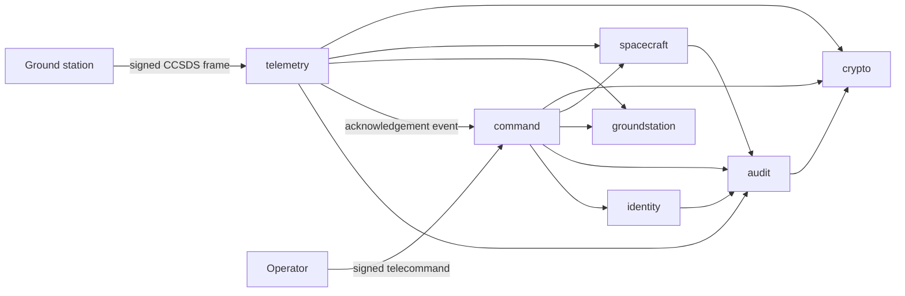

# Satellite Ground Segment

[](https://github.com/justhurky/satellite-ground-segment/actions/workflows/build.yml)
[](https://github.com/justhurky/satellite-ground-segment/actions/workflows/codeql.yml)
[](https://openjdk.org/projects/jdk/21/)
[](https://spring.io/projects/spring-boot)
[](LICENSE)

A backend service for the ground segment of a satellite mission: it ingests authenticated CCSDS
telemetry from ground stations, checks every measurement against its operational limits, and uplinks
operator telecommands only when their digital signature, the mission phase, the operator's role and
an open contact window all allow it. Every state change lands in a hash-chained audit trail that can
be verified after the fact.

The domain is deliberately safety-critical: a wrong or replayed frame must never become a valid
measurement, and a forged command must never reach a spacecraft.

## Why this project exists

I wanted a project that exercises the parts of Java and Spring that matter in a real backend, rather
than another CRUD demo:

- a binary wire format that has to be decoded and validated byte by byte (CCSDS Space Packet)
- cryptography that actually gates behaviour (HMAC-SHA256, Ed25519, AES-GCM, SHA-256 hash chain)
- state machines with explicitly forbidden transitions instead of free-form status fields
- authorisation decisions that depend on domain state, not only on the caller's role
- a database schema owned by migrations and validated against the JPA mapping on every boot
- a test suite that covers the dangerous paths, not just the happy one

## Capabilities

**Telemetry ingestion**

- CCSDS Space Packet primary header and CDS secondary header decoding with strict structural checks
- HMAC-SHA256 frame authentication with a constant-time tag comparison
- A 64-slot sliding-window replay guard, persisted per spacecraft and APID, that survives restarts
  and handles 14-bit sequence-counter wraparound
- Parameter decoding against a per-spacecraft parameter dictionary, with yellow and red limit
  checking that raises acknowledgeable alerts
- Raw payloads sealed at rest with AES-GCM, bound to the spacecraft and APID through the
  additional authenticated data

**Telecommanding**

- Ed25519 signature verification over a canonical, unambiguous byte representation of the command
- A command catalogue in configuration that pins each opcode to a criticality class, the mission
  phases where it is allowed, the role that may issue it, and its payload size
- An eight-state command lifecycle with an explicit transition table
- Replay and duplicate protection through per-spacecraft nonces and a bounded clock-skew window
- A scheduler that dispatches due commands during open ground-station contact windows, respecting
  criticality ordering and the uplink byte budget of the pass
- Spacecraft acknowledgements arrive as telemetry on a dedicated APID and close the command
  lifecycle through an application event

**Operations and auditability**

- Append-only audit log, where each entry hashes the previous one, plus an endpoint that re-verifies
  the whole chain
- Stateless JWT authentication with six operational roles and method-level authorisation
- RFC 7807 problem responses with stable error codes
- Flyway migrations as the single source of truth for the schema, with `ddl-auto=validate`
- Actuator health, Prometheus metrics, and an OpenAPI 3 document with Swagger UI

## Architecture

The service is a modular monolith sliced by domain, not by technical layer. An ArchUnit test proves
the slices stay free of dependency cycles.



| Slice           | Responsibility                                                              |
|-----------------|-----------------------------------------------------------------------------|
| `telemetry`     | frame decoding, authentication, replay guard, limit checking, alerts        |
| `command`       | catalogue rules, signature verification, lifecycle, uplink scheduling       |
| `spacecraft`    | spacecraft registry, mission phases, parameter dictionary and limits        |
| `groundstation` | stations and contact windows with uplink budgets                            |
| `identity`      | accounts, roles, JWT issuing and the security filter chain                  |
| `audit`         | hash-chained audit trail and its integrity verification                     |
| `crypto`        | HMAC, Ed25519 verification, AES-GCM sealing, SHA-256 chaining               |
| `common`        | RFC 7807 error handling, paging, codecs and digests                         |

Further reading: [docs/ARCHITECTURE.md](docs/ARCHITECTURE.md),
[docs/SECURITY.md](docs/SECURITY.md), [docs/API.md](docs/API.md),
[decision records](docs/decisions).

## Running it

Requirements: JDK 21. Maven comes with the wrapper.

```bash
./mvnw spring-boot:run -Dspring-boot.run.profiles=demo
```

The `demo` profile provides development keys, seeds a spacecraft (`HUSAT-1`), two ground stations, a
parameter dictionary, an open contact window and six accounts, all sharing the password
`demo-operator-password`:

| Account       | Role             | May do                                        |
|---------------|------------------|-----------------------------------------------|
| `admin`       | `ADMIN`          | everything                                    |
| `director`    | `FLIGHT_DIRECTOR`| mission phase changes, critical commands      |
| `operator`    | `OPERATOR`       | routine and sensitive commands, contact windows |
| `analyst`     | `ANALYST`        | read telemetry and alerts                     |
| `auditor`     | `AUDITOR`        | read and verify the audit trail               |
| `station-kir` | `GROUND_STATION` | submit telemetry frames                       |

Swagger UI: <http://localhost:8080/swagger-ui.html>

With PostgreSQL instead of the in-memory database:

```bash
docker compose up --build
```

Outside the `demo` profile the service refuses to start without `GROUND_SEGMENT_JWT_SECRET` and
`GROUND_SEGMENT_DATA_ENCRYPTION_KEY`, which is intentional.

## Walkthrough

The demo profile prints the spacecraft id and its telemetry authentication key on startup. Export
both, then log in:

```bash
SPACECRAFT_ID=...
TELEMETRY_KEY=...
TOKEN=$(curl -s -X POST localhost:8080/api/v1/auth/login \
  -H 'Content-Type: application/json' \
  -d '{"username":"station-kir","password":"demo-operator-password"}' | jq -r .accessToken)
```

Build a frame carrying a battery voltage below its red limit and submit it:

```bash
GS_APID=100 GS_SEQUENCE=1 GS_SAMPLES="1:20.5" GS_TELEMETRY_KEY=$TELEMETRY_KEY \
  jshell -q --execution local tools/build-frame.jsh
```

```bash
curl -s -X POST localhost:8080/api/v1/telemetry/frames \
  -H "Authorization: Bearer $TOKEN" -H 'Content-Type: application/json' \
  -d '{"spacecraftId":"'$SPACECRAFT_ID'","groundStationCode":"KIR",
       "frameBase64":"<frameBase64>","authenticationTagBase64":"<authenticationTagBase64>"}' | jq
```

The response carries the decoded frame and the raised `RED` alert. Submitting the same frame again
is answered with `409 FRAME_REPLAY_DETECTED`, and changing a single byte of the frame gives
`401 FRAME_AUTHENTICATION_FAILED`.

Signing a telecommand with the demo mission key and submitting it as the operator:

```bash
GS_SPACECRAFT_ID=$SPACECRAFT_ID GS_OPCODE=ping GS_CRITICALITY=routine \
  GS_NONCE=nonce-0123456789abcdef GS_REQUESTED_AT=$(date -u +%Y-%m-%dT%H:%M:%S.000Z) \
  GS_PRIVATE_KEY=MC4CAQAwBQYDK2VwBCIEINGeR8HngNG/2k1mb8JYBTZI/9pIu5BPPMqQ1DSiUGj7 \
  jshell -q --execution local tools/sign-command.jsh
```

A command whose signature does not verify is still stored, as `REJECTED` with the reason recorded,
and answered with `422`. A `CRITICAL` opcode submitted by an operator is refused with `403`, and one
that its mission phase does not allow with `422`.

Finally, verify the audit trail as the auditor:

```bash
curl -s localhost:8080/api/v1/audit/integrity -H "Authorization: Bearer $AUDITOR_TOKEN" | jq
```

## Tests

```bash
./mvnw verify
```

221 tests run in about 50 seconds, covering 92% of instructions and 84% of branches. The build fails
below 88% and 78%, so the ratchet cannot quietly slip. The suite is deliberately weighted towards the
paths that must not break:

| Kind                   | What it covers                                                                     |
|------------------------|------------------------------------------------------------------------------------|
| Cryptography           | tag and signature forgery, tampering, wrong keys, AEAD context binding, chaining   |
| Frame decoding         | every structural rejection in the CCSDS header, truncation, sample alignment       |
| Replay window          | duplicates, out-of-order inside the window, too-old frames, counter wraparound     |
| State machines         | the full transition tables of the command lifecycle and the mission phases         |
| Authorisation          | catalogue, criticality, mission phase, role and clock-skew rules                   |
| Audit integrity        | tampering with a field, rewriting a link and deleting an entry are all detected     |
| Uplink scheduling      | no contact, tight budgets, criticality order, deferred and future-dated commands    |
| Web layer slice        | request validation and error mapping with mocked services (`@WebMvcTest`)          |
| End-to-end             | the whole mission flow and its failure modes over HTTP (`@SpringBootTest`)         |
| Schema on PostgreSQL   | Flyway migrations and the JPA mapping on a real database (Testcontainers)          |
| Demo profile           | the seeded mission, its keys, its contact window and its audit chain               |
| Architecture           | slice cycles, layering, injection style and immutable payloads (ArchUnit)          |

The PostgreSQL test is skipped when no Docker daemon is available and runs in CI. Beyond the test
suite, every push is analysed by CodeQL with the extended security queries, and Dependabot watches
the Maven, Actions and Docker dependencies.

## Layout

```
src/main/java/io/github/justhurky/groundsegment
├── audit            hash-chained audit trail
├── bootstrap        demo profile seeding
├── command          telecommanding and uplink scheduling
├── common           error handling, paging, codecs
├── config           typed configuration properties, clock, OpenAPI
├── crypto           HMAC, Ed25519, AES-GCM, hash chain
├── groundstation    stations and contact windows
├── identity         accounts, roles, JWT, security filter chain
├── spacecraft       registry, mission phases, parameter limits
└── telemetry        ingestion, replay guard, limit checking, alerts
```

## Technology

Java 21, Spring Boot 3.5 (Web, Data JPA, Security, Validation, Actuator), Hibernate 6, Flyway,
PostgreSQL and H2, JJWT, springdoc-openapi, Micrometer, JUnit 5, AssertJ, Mockito, Testcontainers,
ArchUnit, JaCoCo, Docker, GitHub Actions.

## License

MIT, see [LICENSE](LICENSE).
